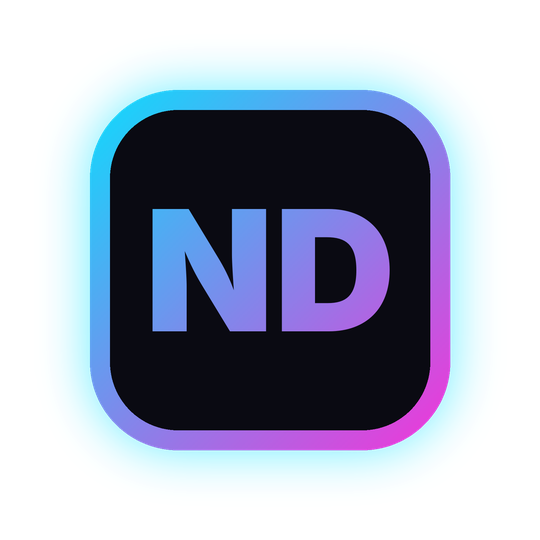
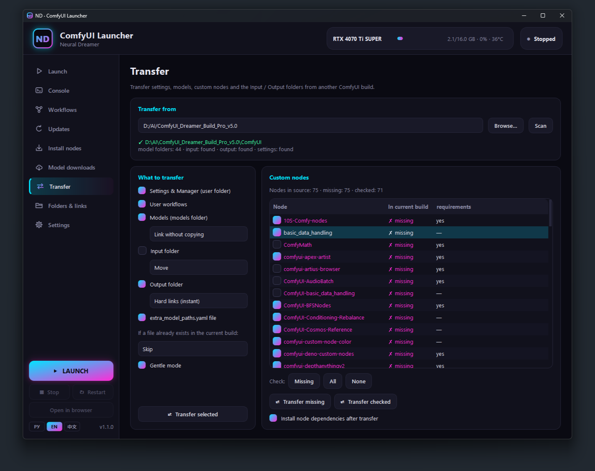

<div align="center">



# ND · ComfyUI Launcher

**A one-window launcher for any portable ComfyUI build on Windows**

[](https://github.com/neural-dreamer/ND-ComfyUI-Launcher/releases/latest)
[](LICENSE)


**English** · [Русский](README.ru.md) · [中文](README.zh-CN.md)

</div>

No more `.bat` files and launch flags to remember. ND Launcher starts ComfyUI with the right settings, updates it and your custom nodes, installs new nodes and models, moves everything over from an old build, and keeps the console, GPU stats and your workflows in one place.


## Features

- **Launch** — ready-made presets (Standard, Save VRAM, Maximum speed, Video & large models, CPU only) plus your own. VRAM mode, attention (SageAttention, FlashAttention), fp8 / fp16, reserved VRAM, LAN access and port as simple controls. One-click desktop shortcut that starts ComfyUI right away, optionally minimized to the tray.
- **Console** — ComfyUI output inside the window with errors highlighted, generation progress, and a GPU monitor (VRAM, load, temperature).
- **Workflows** — every workflow in the build, searchable, with a description panel: what it does, how to use it, and which models it needs, checked against the models you actually have.
- **Updates** — update ComfyUI (with or without dependencies) and all custom nodes in one click; enable or disable nodes without deleting them.
- **Install nodes** — paste one or more repository links (GitHub, GitLab, a branch, or the short `author/repo` form); the node is cloned and its dependencies installed.
- **Model downloads** — paste a Hugging Face or Civitai link, pick files and destination folders, and see free disk space before you start.
  - Files download straight into the chosen folder over up to 16 parallel connections, with no extra tools needed. Hugging Face files are verified with SHA-256.
  - Optionally, Hugging Face can use the official `hf download` with Xet instead.
  - Destination roots can come from your `extra_model_paths.yaml`.
- **Transfer** — move settings, workflows, models, Input / Output, `extra_model_paths.yaml` and custom nodes from another ComfyUI build. Missing nodes are detected automatically. Models can be copied, moved, hard-linked instantly, or linked without copying.
- **Comfort** — 3 themes (Neon, Foggy Night, Classic), 3 languages (English, Russian, Chinese), your browser of choice (or app mode), minimize to tray, single instance.

<p align="center">
  
  
</p>

## Installation

The launcher is distributed as source code: you build `ND_Launcher.exe` on your own PC with one click. A file built on your computer is not marked as downloaded from the internet, so Windows SmartScreen does not block it.

### Build the exe (recommended)

1. Install [Python 3.10 or newer](https://www.python.org/downloads/windows/). In the installer, tick **Add python.exe to PATH**.
2. Download the source: the [latest release](https://github.com/neural-dreamer/ND-ComfyUI-Launcher/releases/latest) → **Source code (zip)**, or **Code → Download ZIP** on this page. Before unpacking, open the zip's **Properties** and tick **Unblock**, so Windows does not warn about the `.bat` files.
3. Unpack it to any folder and run `build_exe.bat`. It needs internet and takes a few minutes the first time; everything it installs stays in the `.build_venv` folder next to it.
4. Take `dist\ND_Launcher.exe` and put it into the root of your portable ComfyUI build, next to the `python_embeded` and `ComfyUI` folders:
   ```
   ComfyUI_windows_portable\
   ├── ComfyUI\
   ├── python_embeded\
   └── ND_Launcher.exe
   ```
5. Run it. The exe needs nothing else installed, and you can copy it to other builds and PCs.

> Some antivirus programs distrust exe files made with PyInstaller, whatever is inside. If yours removes `ND_Launcher.exe`, add an exclusion for it or use the option below.

### Run without an exe

Copy `nd_launcher.py`, `nd_i18n.py`, `nd_icon.ico`, the `brand\` folder and `ND_Launcher.bat` into the root of your build and run `ND_Launcher.bat`. On first start it installs PySide6 into `python_embeded`.

**Requirements:** Windows 10 / 11 (64-bit) and any portable ComfyUI build with `python_embeded`. Optional: [Git for Windows](https://git-scm.com) for updating custom nodes, an NVIDIA GPU for the GPU monitor.

## Good to know

- **Launch flags.** `--enable-manager`, `--enable-manager-legacy-ui` and `--max-upload-size 999` are on by default and can be turned off on the Launch tab. `--enable-manager` needs a recent ComfyUI with the pip version of ComfyUI-Manager: turn it off for older builds.
- **Settings** are stored in `nd_launcher.json` next to the launcher.
- **API tokens** are encrypted with Windows DPAPI: only your Windows user on this PC can decrypt them.
- **Network access.** The launcher sends no telemetry. It goes online only for features you use: downloads, node installs and updates.
- **Example image.** After every ComfyUI update, the launcher replaces `ComfyUI/input/example.png` with the Neural Dreamer logo. In Settings you can choose your own image or turn this off.
- **Workflow descriptions** live in `utils/*.ndesc` (plain JSON). If there are none, the Workflows tab shows just the list. To generate them with an AI model (Claude, ChatGPT and others), use the [ndesc-writer skill](skills/ndesc-writer/SKILL.md). See also the [format spec](docs/NDESC_FORMAT.md) (in Russian) and the [example](utils/workflows.ndesc.example).

## For developers

- **Release.** Bump `VERSION` in `nd_launcher.py`, add a section to [CHANGELOG.md](CHANGELOG.md) and publish a GitHub release with a tag such as `v1.1.0` and the changelog section as notes.
- **Fork branding.** Run `ND_Links_Editor.bat` to change the links shown in the launcher, and replace `brand\example.png` with your own logo. Then build with `build_exe.bat`.

## License

[GPL-3.0-or-later](LICENSE) © 2026 Neural Dreamer. You may use, study, share and modify the launcher; modified versions must stay open under the same license.

ND Launcher is an independent project and is not affiliated with ComfyUI or Comfy Org.

## Links

[YouTube](https://www.youtube.com/@neural_dreamer) · [VK Video](https://vkvideo.ru/@neural_dreamer) · [Boosty](https://boosty.to/neural_dreamer) · [Patreon](https://www.patreon.com/cw/neural_dreamer) · [Civitai](https://civitai.red/user/Neural_Dreamer) · [Hugging Face](https://huggingface.co/NeuralDreamer)
