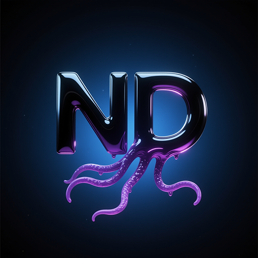
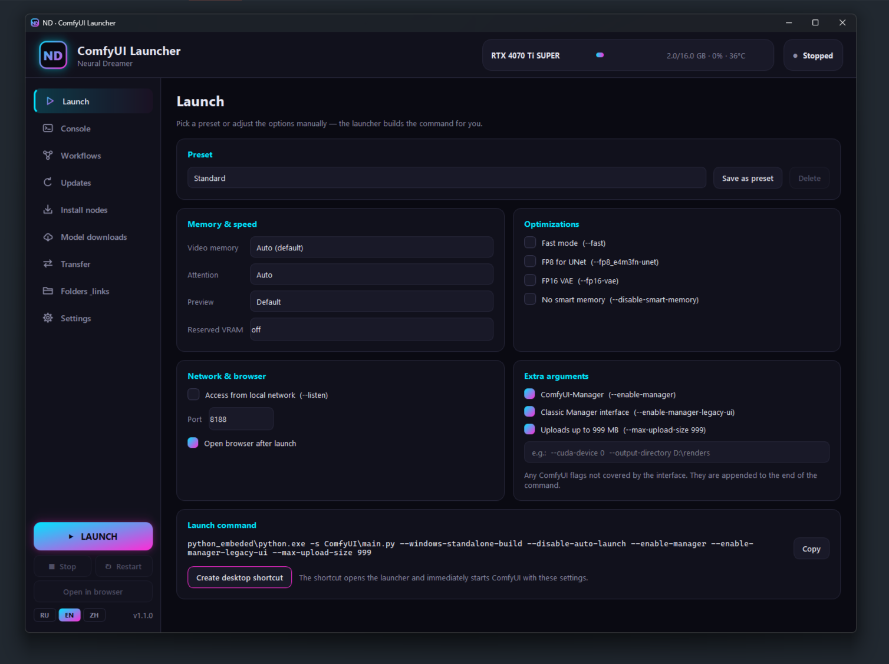
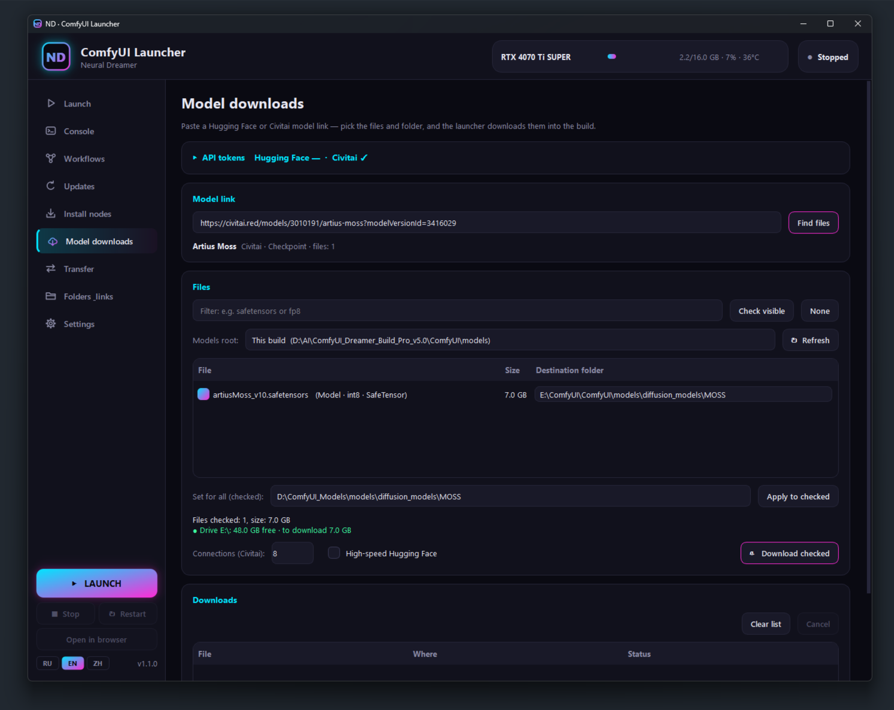

<div align="center">



# ND · ComfyUI Launcher

**适用于 Windows 上任意便携版 ComfyUI 的一站式启动器**

[](https://github.com/neural-dreamer/ND-ComfyUI-Launcher/releases/latest)
[](LICENSE)


[English](README.md) · [Русский](README.ru.md) · **中文**

</div>

不再需要编辑 `.bat` 文件，也不用记住启动参数。ND Launcher 会用合适的设置启动 ComfyUI，更新 ComfyUI 和自定义节点，安装新节点和模型，从旧整合包迁移全部内容，并把控制台、显卡监控和工作流集中在一个窗口里。



## 功能

- **启动** — 内置预设（标准、节省显存、最高速度、视频与大模型、仅 CPU），也可保存自己的预设。显存模式、attention（SageAttention、FlashAttention）、fp8 / fp16、预留显存、局域网访问和端口都以简单选项呈现。一键创建桌面快捷方式，可直接启动 ComfyUI，也可最小化到托盘启动。
- **控制台** — 在窗口内显示 ComfyUI 输出并高亮错误，显示生成进度，以及显卡监控（显存、占用、温度）。
- **工作流** — 整合包中的全部工作流，支持搜索，并有描述面板：用途、使用方法、所需模型和自定义节点，同时检查哪些已经安装。
- **更新** — 一键更新 ComfyUI（可选是否安装依赖）和全部自定义节点；无需删除即可启用或禁用节点。
- **安装节点** — 粘贴一个或多个仓库链接（GitHub、GitLab、分支，或简写 `作者/仓库`），节点会被克隆，依赖会自动安装。
- **模型下载** — 粘贴 Hugging Face 或 Civitai 链接，选择文件和目标文件夹，开始前即可查看磁盘剩余空间。
  - Hugging Face 使用官方的 `hf download` 及 Xet 加速。
  - Civitai 最多 16 个并行连接，无需额外工具。
  - 目标根目录可读取自 `extra_model_paths.yaml`。
- **迁移** — 从另一个 ComfyUI 整合包迁移设置、工作流、模型、Input / Output、`extra_model_paths.yaml` 和自定义节点。缺少的节点会被自动识别。模型可复制、移动、瞬间建立硬链接，或不复制直接链接。
- **便捷** — 3 种主题（霓虹、雾夜、经典）、3 种语言（中文、英文、俄文）、自选浏览器（含应用模式）、最小化到托盘、防止重复启动。

<p align="center">
  
  
</p>

## 安装

1. 从[最新版本](https://github.com/neural-dreamer/ND-ComfyUI-Launcher/releases/latest)下载 `ND_Launcher_vX.Y.Z.zip` 并解压。
2. 将 `ND_Launcher.exe` 放到便携版 ComfyUI 的根目录，与 `python_embeded` 和 `ComfyUI` 文件夹同级：
   ```
   ComfyUI_windows_portable\
   ├── ComfyUI\
   ├── python_embeded\
   └── ND_Launcher.exe
   ```
3. 运行即可，无需安装其他任何东西。

**系统要求：** Windows 10 / 11（64 位），以及任意带 `python_embeded` 的便携版 ComfyUI。可选：用于更新自定义节点的 [Git for Windows](https://git-scm.com)，用于显卡监控的 NVIDIA 显卡。

> **Windows SmartScreen。** 该 exe 未进行代码签名，Windows 可能提示“Windows 已保护你的电脑”。请点击 **更多信息 → 仍要运行**。每个版本都由 [GitHub Actions](.github/workflows/release.yml) 基于本仓库源码构建，你可以核对其中的全部内容。

## 须知

- **启动参数。** `--enable-manager`、`--enable-manager-legacy-ui` 和 `--max-upload-size 999` 默认开启，可在“启动”选项卡中关闭。`--enable-manager` 需要较新的 ComfyUI 以及 pip 版 ComfyUI-Manager，旧版整合包请关闭它。
- **设置**保存在启动器旁的 `nd_launcher.json` 中。
- **API 令牌**使用 Windows DPAPI 加密，只有本机上你的 Windows 用户才能解密。
- **网络访问。** 启动器不发送任何遥测数据，只在你使用相应功能时联网：下载、安装和更新节点。
- **示例图片。** 每次更新 ComfyUI 后，启动器会把 `ComfyUI/input/example.png` 替换为 Neural Dreamer 徽标。可在“设置”中选择自己的图片或关闭此功能。
- **工作流描述**存放在 `utils/*.ndesc`（纯 JSON）。如果没有描述，“工作流”选项卡只显示列表。可使用 [ndesc-writer 技能](skills/ndesc-writer/SKILL.md)让 AI 模型（Claude、ChatGPT 等）生成描述。另见[格式说明](docs/NDESC_FORMAT.md)（俄文）和[示例](utils/workflows.ndesc.example)。

## 从源码运行与构建

- **从源码运行：** 将 `nd_launcher.py`、`nd_i18n.py`、`nd_icon.ico`、`brand\` 文件夹和 `ND_Launcher.bat` 复制到整合包根目录，然后运行 `ND_Launcher.bat`。首次启动时会把 PySide6 安装到 `python_embeded`。
- **本地构建 exe：** 安装 Python 3.10+，然后运行 `build_exe.bat`。生成的 `dist\ND_Launcher.exe` 已内置 `brand\`（链接、图标、徽标）。
- **发布：** 修改 `nd_launcher.py` 中的 `VERSION`，在 [CHANGELOG.md](CHANGELOG.md) 中添加对应章节，然后推送 `v1.1.0` 这样的标签。GitHub Actions 会自动构建 exe 并发布版本。
- **分支自定义品牌：** 运行 `ND_Links_Editor.bat` 修改启动器中显示的链接，并可用自己的徽标替换 `brand\example.png`。

## 许可证

[GPL-3.0-or-later](LICENSE) © 2026 Neural Dreamer。你可以使用、研究、分享和修改本启动器；修改后的版本必须以相同许可证保持开源。

ND Launcher 是独立项目，与 ComfyUI 或 Comfy Org 无关。

## 链接

[YouTube](https://www.youtube.com/@neural_dreamer) · [VK Video](https://vkvideo.ru/@neural_dreamer) · [Boosty](https://boosty.to/neural_dreamer) · [Patreon](https://www.patreon.com/cw/neural_dreamer) · [Civitai](https://civitai.red/user/Neural_Dreamer) · [Hugging Face](https://huggingface.co/NeuralDreamer)
